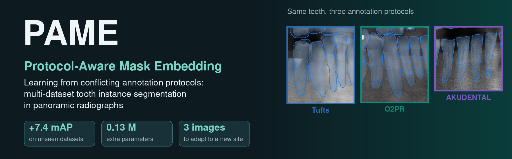
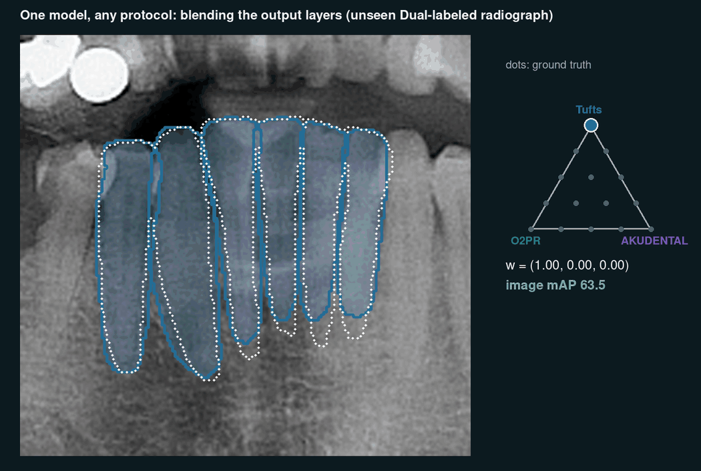
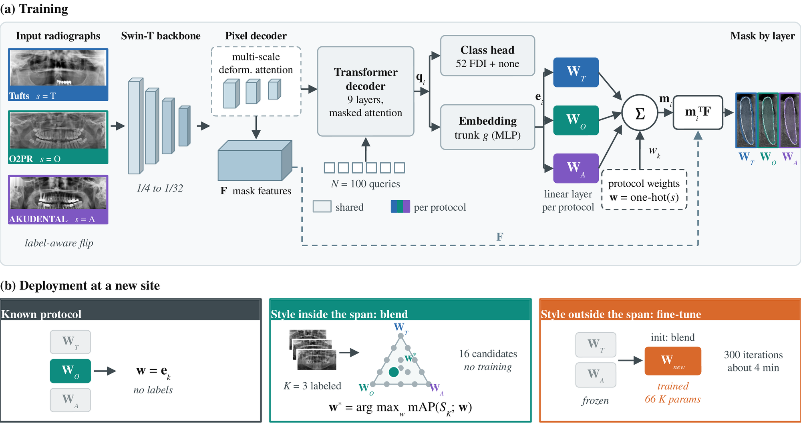
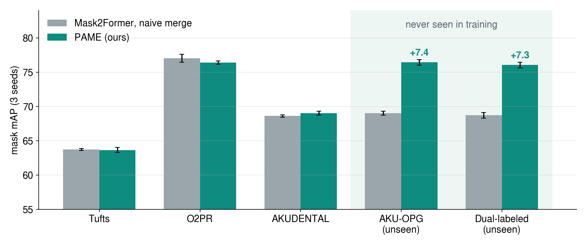
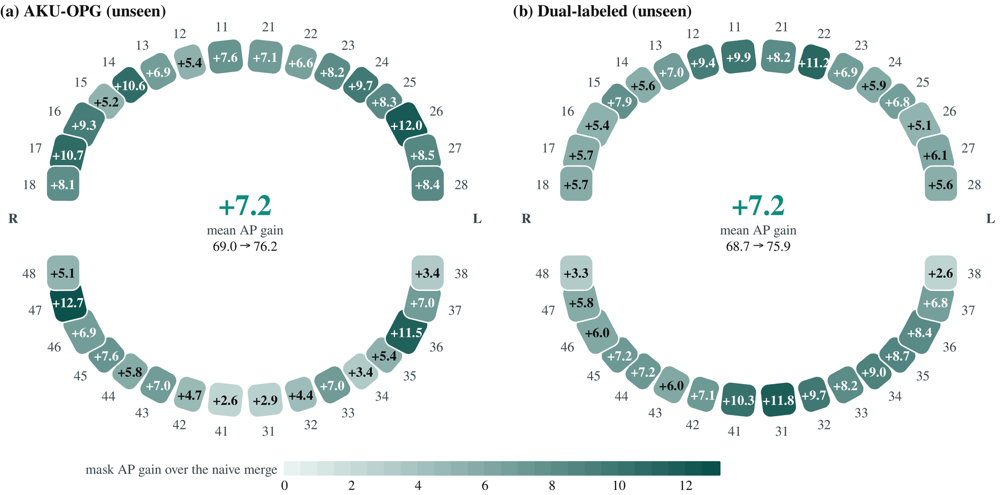
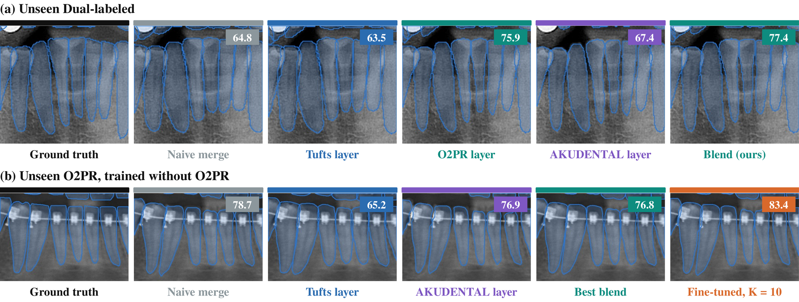
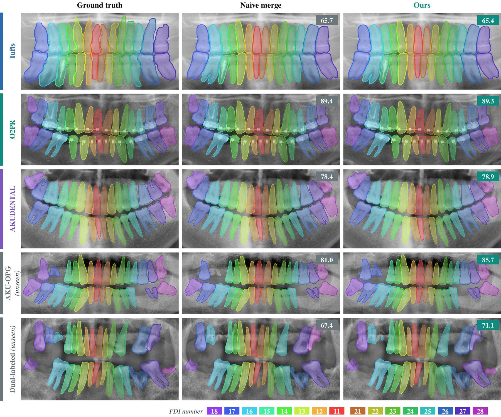

<p align="center">
  
</p>

<p align="center">
  <a href="#installation"></a>
  <a href="#installation"></a>
  <a href="https://github.com/open-mmlab/mmdetection"></a>
  <a href="LICENSE"></a>
  <a href="#citation"></a>
</p>

**PAME** (Protocol-Aware Mask Embedding) trains one tooth instance segmentation and FDI numbering model on several
public panoramic radiograph datasets **whose annotators outline teeth differently**, and lets a new clinic choose or
adapt the outline style from as few as three labeled radiographs.

> Merging public dental datasets naively helps on the training datasets but **hurts on new ones**: one mask head
> learns an average of incompatible annotation protocols. PAME gives every protocol its own linear output layer of
> the Mask2Former mask embedding (0.13 M parameters, no extra inference time). Because masks are linear in that
> layer, blending layers is exact, so a new site picks its protocol with three labeled images and no training.

<p align="center">
  
</p>

## Highlights

- **+7.4 / +7.3 mask mAP on two datasets never used for training** (AKU-OPG, Dual-labeled; 3 seeds, p < 1e-18),
  with no loss on the three training datasets.
- **Every one of the 32 tooth positions improves** on both unseen datasets.
- **Few-shot adaptation:** select a blend of protocol layers from K = 3 labeled images (inference only), or fine-tune
  a single 66 K-parameter layer in about 4 minutes when the new style is unlike any training protocol.
- **Plug-in for MMDetection 3.x:** works with Mask2Former and Mask R-CNN (ResNet-50, Swin-T).
- **Cleaned five-dataset benchmark:** reproducible splits, duplicate images across datasets removed, mirrored labels fixed.

## Method

<p align="center"></p>

A shared Mask2Former (Swin-T backbone, pixel decoder, transformer decoder, class head, mask-embedding trunk) learns
from all images. Each source dataset k owns one linear layer **W**<sub>k</sub>; during training every image is routed
to the layer of its own dataset. At test time the layers are combined with weights **w** on the simplex:
the mask of query i is &sigma;((&Sigma;<sub>k</sub> w<sub>k</sub> **W**<sub>k</sub> **e**<sub>i</sub>)<sup>T</sup> **F**).
We show that a single pooled mask head converges to an appearance-weighted mixture of the protocols, and that
blending PAME layers equals log-linear pooling of protocol experts (see the paper).

## Results

<p align="center"></p>

Mask mAP (class-aware, 52 FDI classes), mean &plusmn; std over 3 seeds. Unseen sets use the blend selected with K = 3 labeled images.

| Model | Tufts | O2PR | AKUDENTAL | AKU-OPG (unseen) | Dual-labeled (unseen) |
|---|---|---|---|---|---|
| Mask2Former, naive merge | **63.7** &plusmn; 0.1 | **77.0** &plusmn; 0.6 | 68.6 &plusmn; 0.2 | 69.0 &plusmn; 0.3 | 68.7 &plusmn; 0.4 |
| **PAME (ours)** | 63.6 &plusmn; 0.4 | 76.4 &plusmn; 0.2 | **69.0** &plusmn; 0.3 | **76.4** &plusmn; 0.4 | **76.0** &plusmn; 0.4 |

<details>
<summary><b>Per-tooth gain, protocol styles, and qualitative results</b></summary>

<p align="center"></p>
<p align="center"></p>
<p align="center"></p>
</details>

## Installation

```bash
conda create -n pame python=3.10 -y && conda activate pame
pip install torch==2.1.2 torchvision==0.16.2 --index-url https://download.pytorch.org/whl/cu118
pip install -U openmim && mim install mmengine "mmcv==2.1.0" "mmdet==3.3.0"
pip install -r requirements.txt
pip install -e .            # installs the `pame` plugin (registered through custom_imports in the configs)
```

## Data

No images or annotations are redistributed. Download each dataset from its source and build the unified
annotations with our scripts; the result is checked against the split lists in [`splits/`](splits). See
[docs/DATASETS.md](docs/DATASETS.md) for download links, licenses, and the expected folder layout.

```bash
bash tools/prepare_tufts.sh /path/to/SADP-Net data/raw/tufts data 0
python tools/prepare_data.py --tufts data/tufts_seed0 --o2pr data/raw/o2pr --akudental data/raw/akudental \
    --aku-opg data/raw/aku_opg --dual data/raw/dual_labeled --out data/annotations
```

## Training

```bash
# PAME on Tufts + O2PR + AKUDENTAL (one RTX 4090, about 6 h)
python tools/train.py configs/pame_m2f_swin-t_toa.py --work-dir work_dirs/pame_m2f_swin-t_toa
# naive-merge baseline
python tools/train.py configs/naive_m2f_swin-t_toa.py --work-dir work_dirs/naive_m2f_swin-t_toa
```
Other seeds: `--cfg-options randomness.seed=1`. Leave-one-dataset-out configs are in `configs/lodo/`.

## Evaluation

```bash
# one protocol layer (0 Tufts, 1 O2PR, 2 AKUDENTAL) or a blend of layers
python tools/infer.py configs/pame_m2f_swin-t_toa.py CKPT --ann data/annotations/test_Dual_labeled.json \
    --out preds/pame_dual_b121.pkl --blend 0.25,0.5,0.25
python tools/evaluate.py --pred preds/pame_dual_b121.pkl --ann data/annotations/test_Dual_labeled.json
```

## A new site: few-shot protocol selection and fine-tuning

```bash
# 1) predictions of each candidate (single layers and blends) on the new site's images, then select with K labeled images
python tools/fewshot_select.py --ann data/annotations/test_AKU_OPG.json T=preds/h0.pkl O=preds/h1.pkl A=preds/h2.pkl \
    b121=preds/b121.pkl b130=preds/b130.pkl --K 3
# 2) style outside the span of the training protocols: fine-tune one new layer (300 iterations)
python tools/init_new_layer.py work_dirs/pame_m2f_swin-t_ta/epoch_50.pth work_dirs/pame_m2f_swin-t_ta/init_slot1_b75.pth \
    --slot 1 --weights 0.75,0,0.25
python tools/train.py configs/fewshot/pame_finetune_o2pr_k3.py --work-dir work_dirs/finetune_o2pr_k3
```

## Model zoo and predictions

Trained checkpoints and test-set predictions are listed in [docs/MODEL_ZOO.md](docs/MODEL_ZOO.md).

## Repository layout

```
pame/        plugin: ProtocolMask2FormerHead, ProtocolRoIHead, AddSourceId, RandomFlipFDI
configs/     naive and PAME Mask2Former, leave-one-dataset-out, few-shot fine-tuning
tools/       data preparation, inference, evaluation (segmentation + numbering), few-shot selection, significance
splits/      image lists of every split used in the paper, removed duplicates
docs/        datasets, model zoo
```

## Citation

```bibtex
@article{pame2026,
  title   = {Learning From Conflicting Annotation Protocols: Protocol-Aware Multi-Dataset Tooth Instance
             Segmentation in Panoramic Radiographs},
  author  = {Habib Khan, Faleh AlQahtani, Abeer D. Algarni, and Hela Elmannai},
  journal = {IEEE Transactions on Medical Imaging},
  note    = {under review},
  year    = {2026}
}
```

## Acknowledgments

Built on [MMDetection](https://github.com/open-mmlab/mmdetection) and Mask2Former. Tufts annotations are converted
with the scripts of [SADP-Net](https://github.com/qklee-lz/SADP-Net). We thank the authors of the Tufts Dental
Database, O2PR (OdontoAI), AKUDENTAL, AKU-OPG, and Dual-labeled datasets for making their data available.

## License

Code: [Apache 2.0](LICENSE). Model weights and predictions are derived from datasets with non-commercial terms and
are released for **non-commercial research use only** (see [docs/MODEL_ZOO.md](docs/MODEL_ZOO.md)). Not a medical device.
